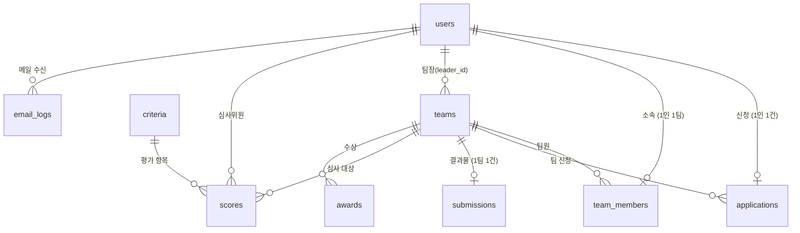

# DB 설계

연합 해커톤 웹사이트의 데이터 구조와 권한 설계. 기준: `연합해커톤_웹사이트_필수기능_v10.md` + 이후 변경(평가: 상호 평가 → 외부 심사위원).
테이블 정의: [`supabase/migrations/0001_init.sql`](../supabase/migrations/0001_init.sql)

## 전체 구조

```
브라우저 ──(쿠키 세션)──▶ Next.js (Vercel)
                          ├─ NextAuth: Google 로그인, 도메인 확인, 세션(JWT)
                          └─ app/api/* : 권한 확인 → Supabase (service role 키)
                                                      ├─ Postgres (테이블)
                                                      └─ Storage (제출 파일)
```

- **로그인**: NextAuth(Auth.js) + Google. 로그인 직후 `signIn` 콜백에서 이메일 도메인이 `allowed_domains`에 있거나 이메일이 `invited_emails`에 있을 때만 통과시키고, `users` 행을 만들거나 갱신한다.
- **데이터 접근**: 브라우저는 Supabase에 직접 접근하지 않는다. 모든 읽기·쓰기는 API 라우트가 service role 키로 하고, "누가 무엇을 할 수 있는지"는 서버 코드에서 확인한다.
- **RLS**: 모든 테이블에 RLS를 켜고 정책을 두지 않는다. 혹시 anon 키가 노출돼도 아무 데이터도 읽거나 쓸 수 없다.
- **service role 키는 서버 환경변수에만** 둔다 (`NEXT_PUBLIC_` 접두사 금지).

## 관계도



## 테이블

| 테이블 | 내용 | 기획서 |
|---|---|---|
| `allowed_domains` | 로그인 허용 학교 도메인 → 소속 학교 | 개요 · 기능 2 |
| `invited_emails` | 학교 계정이 아닌 초청자(심사위원·운영진) 로그인 허용 목록 | 변경 사항 |
| `users` | 계정 · 프로필(이름, 학번, 연락처, 동의) · 역할(`participant`/`judge`/`admin`) | 기능 2 |
| `event_config` | 단계별 일정, 결과 공개 여부, 팀 인원 조건 (한 행) | 기능 9 일정 관리 |
| `applications` | 참가 신청 (사람마다 1건), 선발 결과 | 기능 3 · 9 |
| `teams` | 팀 (신청한 팀 / 운영진이 구성한 팀), 참가 코드, 팀장, 발표 순서 | 기능 3 · 4 · 9 |
| `team_members` | 팀 소속 (한 사람은 한 팀에만), 팀 내 역할 | 기능 3 · 4 |
| `submissions` | 결과물 (팀마다 1건), 파일 경로, 프로토타입 링크 | 기능 5 · 6 |
| `criteria` · `scores` | 평가 항목(점수 범위·가중치), 심사위원 점수 — **점수 방식 미정** | 기능 7 (변경) |
| `awards` | 수상 내역 | 기능 8 |
| `email_logs` | 선발 결과·팀 배정 메일 발송 기록 | 메일 발송 |

## 주요 흐름

**최초 로그인**
1. Google 로그인 → 도메인/초청 목록 확인 → 없으면 차단
2. `users` 행 생성. 초청 목록에 있으면 학교 메일이어도 초청자로 보고 `invited_emails.role`로 `role`을 정한다(`school`은 비움). 아니면 `school`을 도메인으로 채운다
3. `profile_completed_at`이 비어 있으면 프로필 입력 화면으로 보낸다

**개인 신청**: `applications(kind='solo')` 작성 → 마감 전까지 수정 → 제출(`submitted`)

**팀 신청**
1. 대표가 팀 생성 → `teams(origin='applied', join_code 발급, leader_id)` + 대표의 `team_members`·`applications(kind='team')`
2. 팀원이 참가 코드로 합류 → `team_members` + 각자의 `applications(kind='team', team_id)`
3. 인원 조건(`event_config.team_min_size ~ team_max_size`) 충족 시 대표가 제출 → 팀원 전원의 `applications.status = 'submitted'`, `teams.application_submitted_at`

**선발**: 운영진이 승인/거절 → `applications.status`, `decided_at` (팀 신청은 팀원 전원 함께) → 결과 메일 일괄 발송(`email_logs`)
- 선발 발표 시각(`selection_announce_at`) 전에는 미리 정해 둔 결과가 참가자에게 '제출'로 보이고, 내 팀 기능도 막힌다 (`0007_selection_announce.sql`). 비어 있으면 정하는 즉시 공개

**팀 배정**: 운영진이 승인된 개인 참가자로 `teams(origin='assigned')`를 만들고 `team_members` 추가 → 배정 메일 발송. 배정된 팀은 팀에서 팀명 입력

**결과물 제출**: 팀장이 `submissions` 작성·수정 (마감 전까지), 팀원은 열람. 파일은 Storage `submissions` 버킷
- 규칙: `supabase/migrations/0004_team.sql`. 제출 기간은 `event_start_at` ~ `submit_deadline_at` (비어 있으면 그쪽 제한 없음)
- 임시 저장은 프로젝트명만 있으면 되고, 제출하려면 프로토타입 링크·발표자료·GitHub 저장소·제출 서약이 필요하다. 한 번 제출하면 마감 전까지 고칠 수 있지만 필수 항목은 비울 수 없다
- 파일 업로드: 서버가 서명된 업로드 주소(`{팀 id}/{slides|cover}-{uuid}.{확장자}`)를 주고 브라우저가 Storage에 바로 올린다 (Vercel 요청 크기 제한 4.5MB를 피함). 저장할 때 DB 함수가 `storage.objects`에서 그 파일이 이 팀 폴더에 실제로 있는지, 종류·크기가 맞는지 확인한다. 저장 뒤 팀 폴더에서 결과물이 쓰지 않는 파일(교체된 옛 파일, 올리기만 하고 저장하지 않은 파일)을 지우고, 운영진이 마지막 팀원을 빼 팀이 없어지면 그 팀 폴더도 비운다
- 팀장이 없는 배정 팀은 팀원 누구나 팀명을 정할 수 있고, 결과물은 운영진이 팀장을 정한 뒤 제출한다. 팀명·역할은 제출 마감 뒤에는 바꿀 수 없다
- 운영진이 배정한 팀은 `team_assign_at` 전에는 팀원에게 보이지 않는다 (배정 대기로 표시)

**안내 메일**: 관리자 페이지 > 메일에서 종류별로 일괄 발송 (Resend). 규칙: `supabase/migrations/0006_mail.sql`
- 선발 결과: 승인·거절이 정해진 신청자 전원. 팀 배정: 운영진이 배정한 팀(`origin='assigned'`)의 팀원
- `email_logs.ref`에 무엇을 알렸는지(선발 결과는 결정, 팀 배정은 팀 id)를 남기고, 마지막으로 보낸 `ref`와 지금이 다른 사람만 보낸다
- 보내기 전에 `mail_claim`이 대상마다 `queued` 기록을 만든다. 보내는 중인 기록은 한 사람당 하나만 둘 수 있어(부분 유니크 인덱스) 동시에 두 번 눌러도 한 번만 나간다. 10분 넘게 `queued`면 끊긴 것으로 보고 실패 처리

**프로젝트 갤러리** (`/projects`, `src/lib/projects.js`): 권한표의 '결과물 열람'을 따른다
- 운영진은 항상(임시 저장 포함), 심사위원은 심사 시작(`judging_start_at`) 뒤 최종 제출만, 참가자는 결과 공개 전에는 자기 팀만, 결과 공개(`results_published_at`) 뒤에는 누구나 최종 제출을 본다
- 공개되면 팀원 이름·소속 학교·팀 안 역할도 보인다 (이메일·연락처는 보이지 않음). 볼 수 없는 프로젝트 상세는 없는 페이지와 같게 404

**심사·결과**: 심사위원이 `scores` 입력 → 운영진 확인 → 수상 팀 지정(`awards`) → `event_config.results_published_at` 설정 시 공개
- 평가 항목(`criteria`: 점수 범위·가중치·순서)은 관리자 > 심사에서 정하고, 첫 화면 '평가 방식'에도 그대로 보인다. 이미 점수가 있는 항목은 점수 범위를 바꿀 수 없다
- 심사위원은 `/review`에서 최종 제출한 팀마다 모든 항목을 매겨 저장한다 (`judge_save_scores`, `0008_judging.sql`). 심사 기간(`judging_start_at`~`judging_end_at`)에만, 심사위원 역할만. 자기 점수만 본다
- 순위는 관리자 > 심사에서 본다. 합산 기본안: 항목마다 심사위원 평균 × 가중치의 합, 총점이 같으면 같은 순위 (`src/lib/scoring.js` — 방식이 정해지면 이 파일만 바꾼다). 운영진이 심사위원·팀 단위로 점수를 무효 처리하면 집계에서 빠진다

## 권한 (서버에서 확인)

| 기능 | 누구나 | 로그인 | 참가자(승인) | 팀장 | 심사위원 | 운영진 |
|---|---|---|---|---|---|---|
| 소개 페이지 | ✓ | ✓ | ✓ | ✓ | ✓ | ✓ |
| 내 정보 | | ✓ | ✓ | ✓ | ✓ | ✓ |
| 참가 신청 (신청 기간) | | ✓ | | | | |
| 내 팀 | | | ✓ | ✓ | | ✓ |
| 결과물 제출·수정 (마감 전) | | | | ✓ | | ✓ |
| 결과물 열람 | 결과 공개 후 | | 자기 팀 | 자기 팀 | 심사 기간 | ✓ |
| 심사 (심사 기간) | | | | | ✓ | ✓ |
| 결과 발표 | 공개 후 | | | | | ✓ |
| 관리자 | | | | | | ✓ |

## 환경변수

| 이름 | 용도 | 노출 |
|---|---|---|
| `SUPABASE_URL` | Supabase 프로젝트 주소 | 서버 |
| `SUPABASE_SERVICE_ROLE_KEY` | 서버 전용 DB 키 | **서버만, 절대 공개 금지** |
| `AUTH_SECRET` | NextAuth 세션 암호화 | 서버 |
| `AUTH_GOOGLE_ID` · `AUTH_GOOGLE_SECRET` | Google OAuth 클라이언트 | 서버 |
| `RESEND_API_KEY` | 메일 발송 | 서버 |
| `MAIL_FROM` | 발신 주소 (예: `연합 해커톤 <noreply@도메인>`) | 서버 |

로컬은 `.env.local`(git 제외), 운영은 Vercel 프로젝트 환경변수에 넣는다.

## 결정 사항

| 항목 | 결정 |
|---|---|
| 로그인 도메인 | 한양대 `hanyang.ac.kr` · 성균관대 `g.skku.edu` · 서강대 `u.sogang.ac.kr` |
| 심사위원 로그인 | 모두 Google 계정 보유 → 운영진이 `invited_emails`에 등록 |
| 팀 인원 | 팀 신청·운영진 배정 팀 모두 2~4명 (`event_config.team_min_size`·`team_max_size`) |
| 메일 발송 | Resend (`RESEND_API_KEY`, `MAIL_FROM`) |
| 제출 파일 | 발표자료 PDF 20MB · 대표 이미지 5MB(png/jpg/webp)만 업로드. 프로토타입은 링크로만 |
| 일정 | `event_config`(관리자 페이지 > 일정) 한 곳에서 관리하고 첫 화면도 이 값을 쓴다. `results_announce_at`은 안내용, 결과 공개는 `results_published_at` (`0005_schedule.sql`) |

## 남은 결정

1. **점수 방식** — 미정. 합산은 기본안(항목별 평균 × 가중치의 합)으로 구현해 두었다. 지금 설계는 평가 항목마다 최저·최고점(`min_score`·`max_score`)과 가중치를 둬서 1~5점, 1~10점, 항목별 배점제 어느 쪽이든 담을 수 있다. 합산 방식(가중 평균 / 합계 / 심사위원별 정규화 등)이 정해지면 결과 계산만 맞추면 된다
2. **메일 발신 도메인** — 쓸 예정이지만 미정. 정해지면 Resend에서 도메인 인증 후 `MAIL_FROM`을 그 주소로 바꾼다. 그 전에는 Resend 테스트 발신 주소로만 보낼 수 있다(본인 계정 메일로만 수신)
